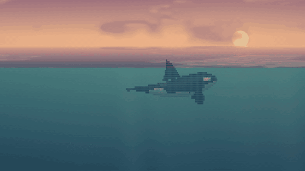
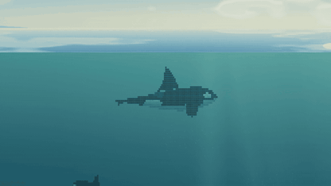
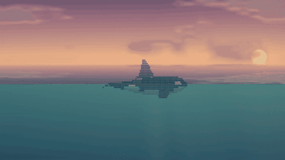
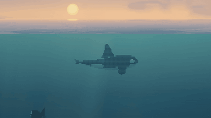
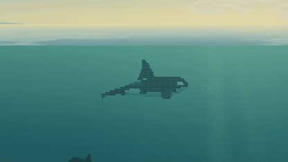

# 潮汐之间 · ASCII Orca

**在 DeepSeek Harness 里，养三头虎鲸。**

| 水下翻滚 | 浮出水面 · 喷水 · 下潜 |
| :---: | :---: |
|  |  |

| 自在巡游 | 追赶鱼群 |
| :---: | :---: |
|  |  |

一片由 ASCII 字符绘成的三维海洋，陪你从日出到深夜。三头虎鲸自在游动、翻滚、潜入深海，偶尔浮出水面喷水、追赶鱼群，或跃出海面，溅起一片浪花。

海里的每一刻都在实时演算。忙累了，就停下来看看鲸鱼。

## 一天里的海

海洋会随电脑的本地时间变换光色，也可以停留在你最喜欢的时刻。

| 深夜 | 凌晨 | 日出 | 正午 |
| :---: | :---: | :---: | :---: |
|  |  |  |  |

| 下午 | 黄昏 | 晚霞 | 傍晚 |
| :---: | :---: | :---: | :---: |
|  |  |  |  |

## 调成你喜欢的样子

- **三种海天构图**，选择更开阔的天空，或更深邃的海底。
- **自由调整亮度、饱和度与柔化**，让海洋融入你的聊天窗口。
- **支持安静游动与暂停**，按自己的节奏看海；安装后可离线使用。

## 把海带回去

已收录 **DSH 插件市场**。打开「设置 → 插件市场」，搜索 **dsh-whalepaper**，安装并启用即可。

点击右下角 **≈**，或进入「设置 → 插件 → 配置 dsh-whalepaper」，就能调整壁纸。

喜欢这片海，欢迎点一颗 **Star**，也欢迎分享你的桌面。

## 许可

[MIT](LICENSE) · 第三方项目致谢见 [THIRD_PARTY_NOTICES.md](THIRD_PARTY_NOTICES.md)。
