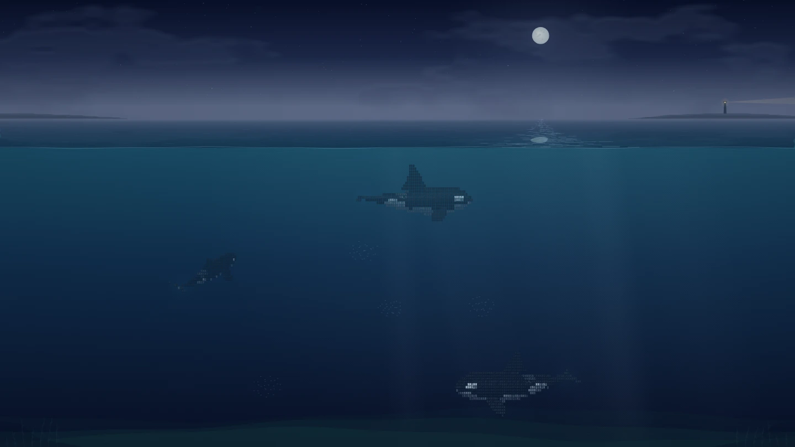
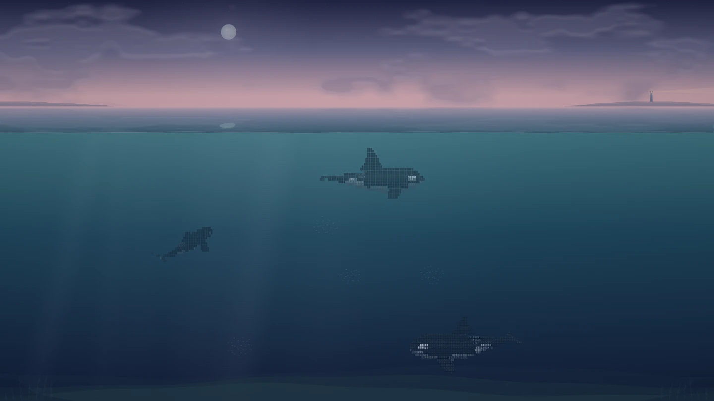
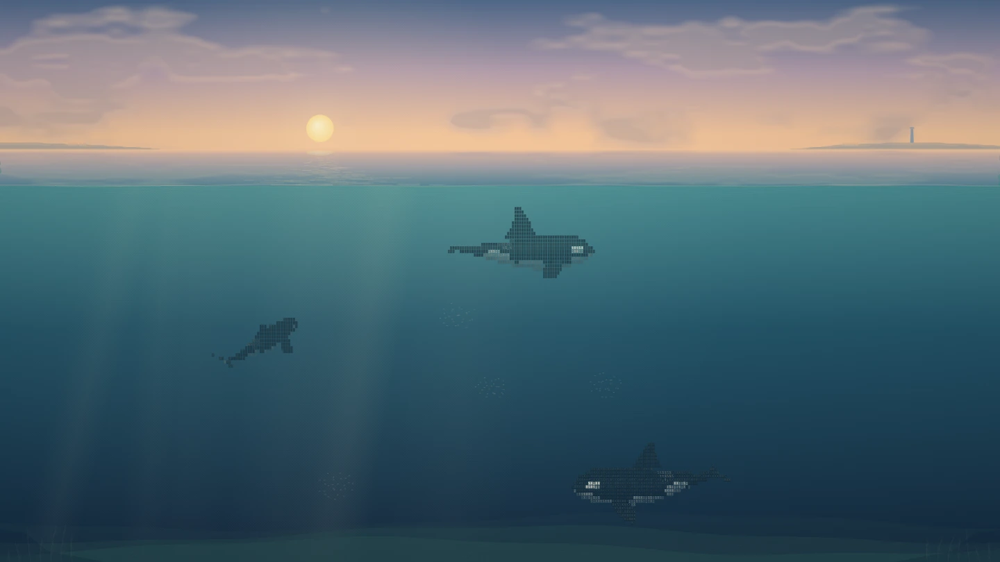
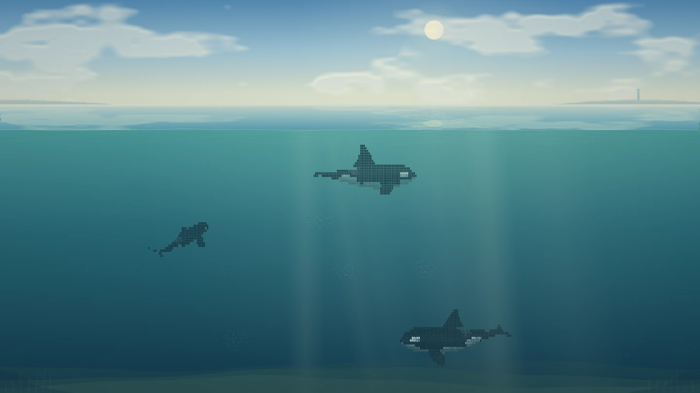
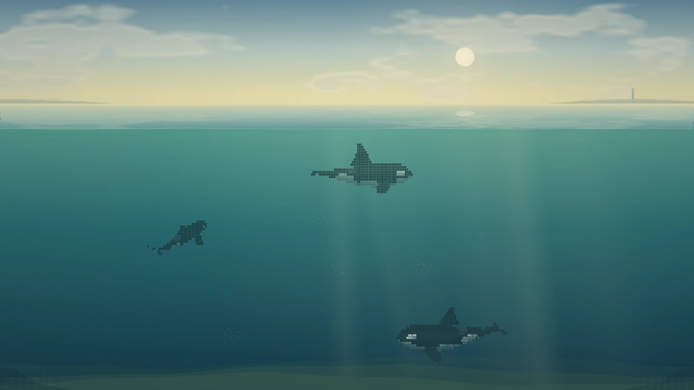
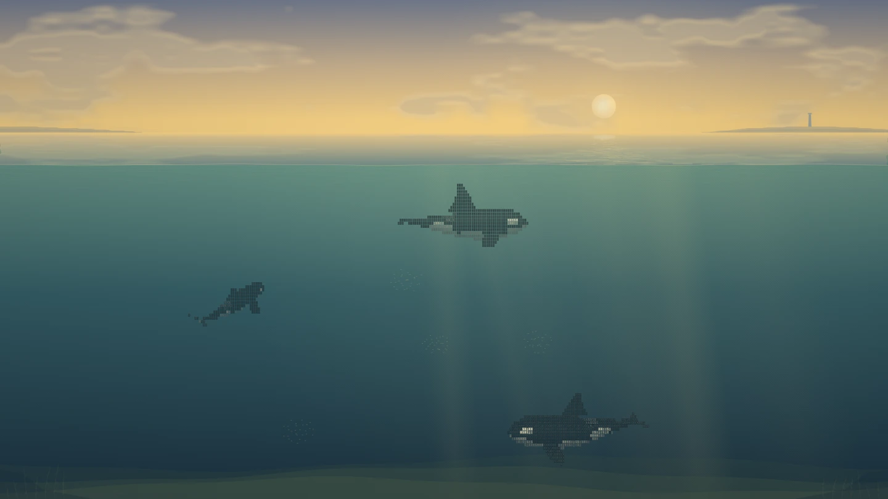
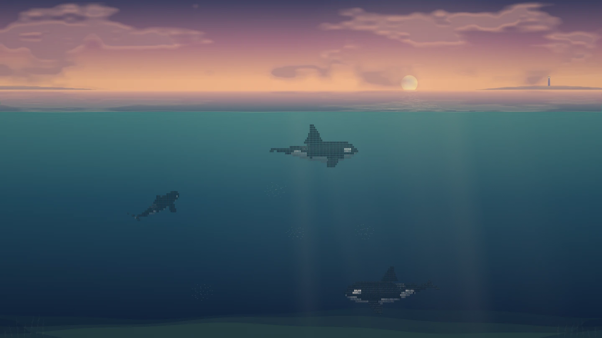
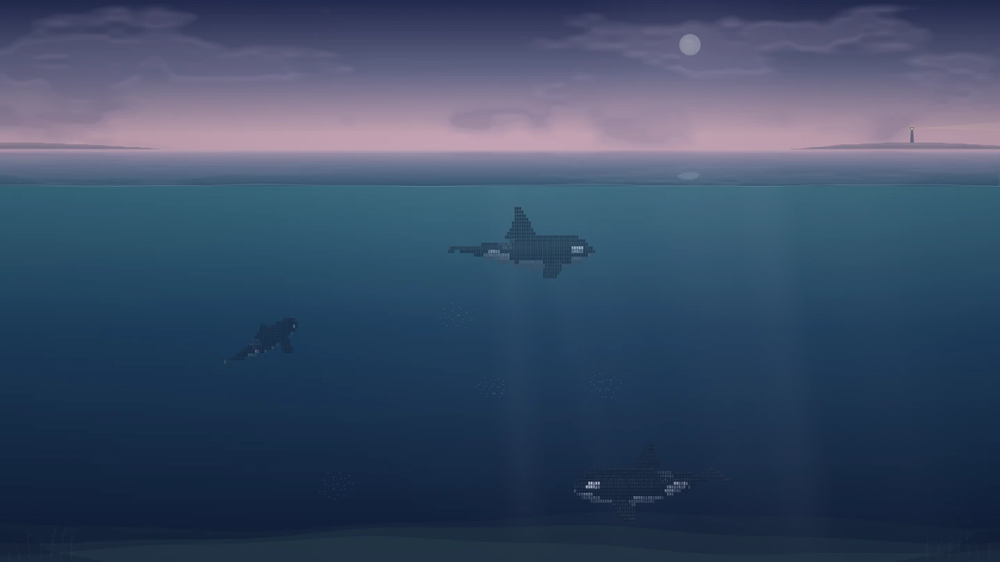

这也许是最适合deepseekharness的壁纸了。在这个壁纸里，你可以养三头虎鲸，它们生活的海洋，会随着电脑的本地时间改变。

你看到的不是提前录好的视频，而是一片实时演算的海洋。三头虎鲸会自己跳水、翻滚、潜水，浮出水面喷水，偶尔还会追赶鱼群。

欢迎各位使用，star

# 潮汐之间 · ASCII Orca for DeepSeek Harness

独立、离线可用的三维 ASCII 虎鲸壁纸。八个时段：深夜、凌晨、日出、正午、下午、黄昏、晚霞、傍晚；也可按设备当地时间平滑过渡。提供28%、33%和38.2%水上空间的三种构图。

正常模式以巡游、滑行、近海床深潜和觅食为主。小鱼是持续运动的个体，会逃离追逐。换气以真实露出水面的呼吸孔为起点，只有部分换气出现可见雾气。跃出是很少发生的背景事件；落水产生冠状飞溅、泡沫、涟漪和水下气泡。

## 一天里的海

同一片海在一天中的不同光色，均由壁纸渲染器实时绘制（1440×810）：

| 深夜 0:00 | 凌晨 4:42 | 日出 6:24 | 正午 12:00 |
| :---: | :---: | :---: | :---: |
|  |  |  |  |

| 下午 15:00 | 黄昏 17:00 | 晚霞 18:00 | 傍晚 19:12 |
| :---: | :---: | :---: | :---: |
|  |  |  |  |

## 先看适配预览

构建资源中的 `wallpaper/harness.html` 提供单一深海色、无遮盖的聊天预览，直接使用同一份客户端适配器。它只保留本地示例，不连接真实会话。用户确认的默认值为水上33%、亮度97%、饱和度111%、柔化0.3px，开启安静游动和壁纸、关闭暂停。完整配置在 `default-settings.json`。

## 原生插件设置

0.6.0 起设置接入 DSH 原生插件设置页：安装并启用后，在「设置 → 插件 → 配置 dsh-whalepaper」即可调整海洋时刻、海天构图、亮度、饱和度、柔化、安静游动、暂停、显示壁纸并恢复默认。设置由插件 `Config` schema 声明（8 个字段全部 `.volatile()`，Host 据此生成表单），写入经当前 profile 的 Cordis patch 持久化并热应用，刷新/重启后保留。插件同时保留右下角 `≈` 快速面板，两处修改共用同一份状态；每个控件只写自己那个字段，不会顺带改动其它设置。接入细节见 [DSH-HANDOFF.md](docs/DSH-HANDOFF.md)。

0.6.0 移除「阅读方案 preset」与「正文保护 glass」两个旧开关：正文固定直显无遮罩，只保留这一套已确认的默认参数；旧配置里的这两个字段会被忽略。

## 侧栏玻璃态（0.6.0）

0.6.0 起左侧导航栏也随壁纸变化：原生侧栏与标题行通过 `--dsw-specific-sidebar-fill` token 保持透明；对自带侧栏表面的第三方插件（例如 @michengai/dsh-codex-ui 的 `.dcu-root`）自动启用了它的 `data-we-sidebar-glass` 玻璃模式，并注入 `--we-sidebar-*` 参数（深色为 33% 深蓝罩层 + 10px 背景模糊，浅色为 36% 亮色罩层）。关闭壁纸或卸载插件时会恢复这些属性的原值。若仍看到不透明左栏，通常是另一个背景/皮肤插件同时绘制侧栏，可先单独启用本壁纸对比。

若宿主未显示「配置」卡片，说明客户端 `plugins.bundle.config` 卡片未注册成功，请回退到 `≈` 面板，并在插件管理页检查客户端 bundle 是否加载。

## 安装

带完整构建资源，安装时不需要在本地构建。收录进 DSH 插件市场后，可直接在「设置 → 插件市场」安装；也可以从仓库安装（把 `<owner>` 换成仓库属主）：

```text
dsh plugin --profile <实际使用的profile> add github:<owner>/dsh-whalepaper
```

或下载 Release 中的 `dsh-whalepaper.tgz` 后本地安装：

```text
dsh plugin --profile <实际使用的profile> add "<tgz 的绝对路径>"
```

重启是否需要由该 profile 的 HMR 设置决定。路径安装、tarball spec 与仓库安装属于 DSH 插件管理器公开支持的输入形式。

启用后右下角 `≈` 按钮可快速设置光色、海天构图、显示、暂停并恢复默认；正式入口是「设置 → 插件 → 配置」卡片。宿主表单可用时写入 profile 设置（原生模式），预览页等无宿主表单的环境回退到本地存储，刷新后均保留。默认不为正文和输入区添加遮盖，滤镜仅作用于背景。插件停用会撤回本包节点、样式、监听器并释放 iframe。

有不透明顶部栏时，宿主可设置CSS变量 `--orca-top-inset` 为实际占用高度；背景画布会避开该栏，防止月亮被挡住。预览已按自身52px工具栏留位。

## 验证范围

已做同一渲染器的连续帧核验、长时间生态/事件验收、重复启停与旧实例清理测试、Config schema 默认值/字段校验，以及真实静态资源路由与发行文件清单检查。0.6.0 已在用户的 DSH 桌面 0.2.0-rc.2 本地 profile 实装：`/ascii-orca/index.html` 返回 200、客户端 bundle 进入宿主 boot 组合、`harness.log` 无本插件报错；插件设置卡与实时生效仍以用户界面目视确认为准。不同宿主版本或其他主题插件可能需要调整表面透明度；建议先单独启用本壁纸，避免多个背景插件同时绘制。

本包核对了当前官方客户端模块工厂及 `webServer.register` 契约，使用语义选择器和已存在的 DSH 表面 token，不依赖 CSS 模块哈希，不使用不存在的 `shell.background` slot。

## 许可

MIT，见 [LICENSE](LICENSE)。
